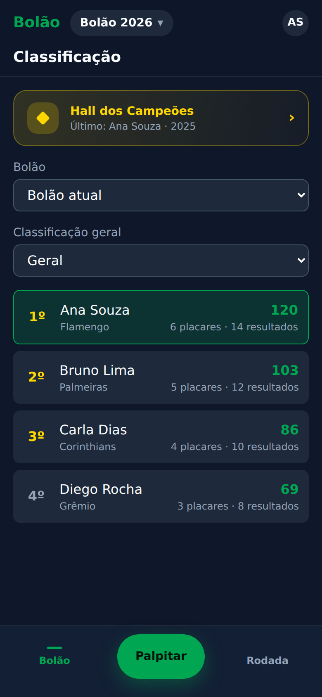
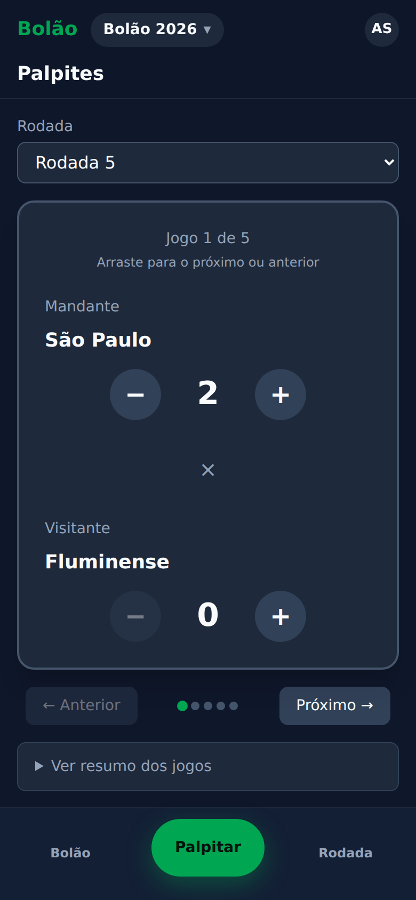
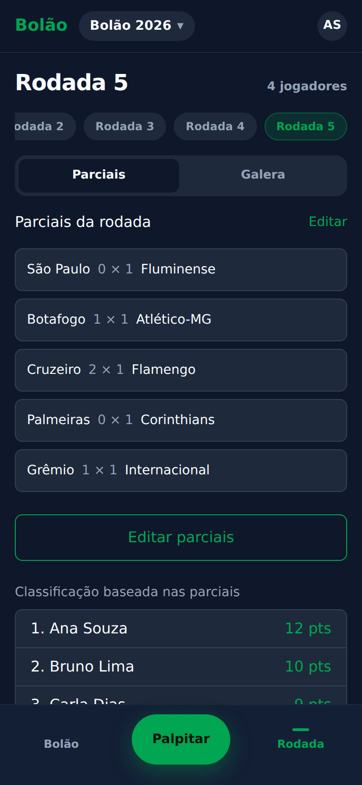
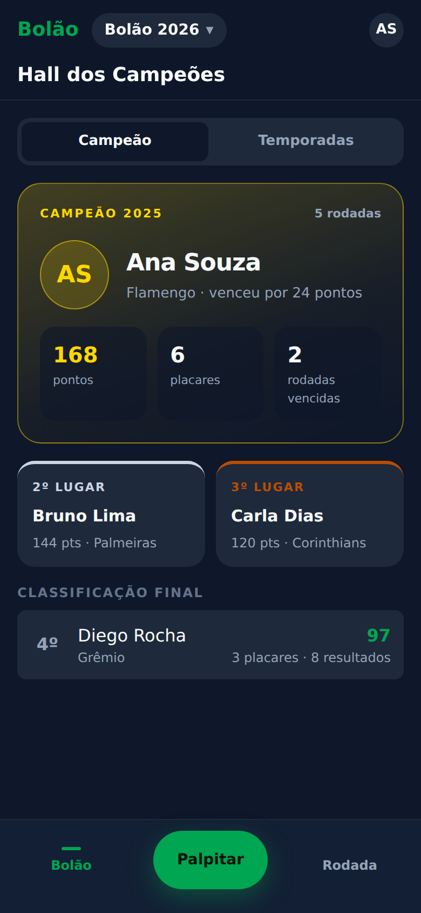
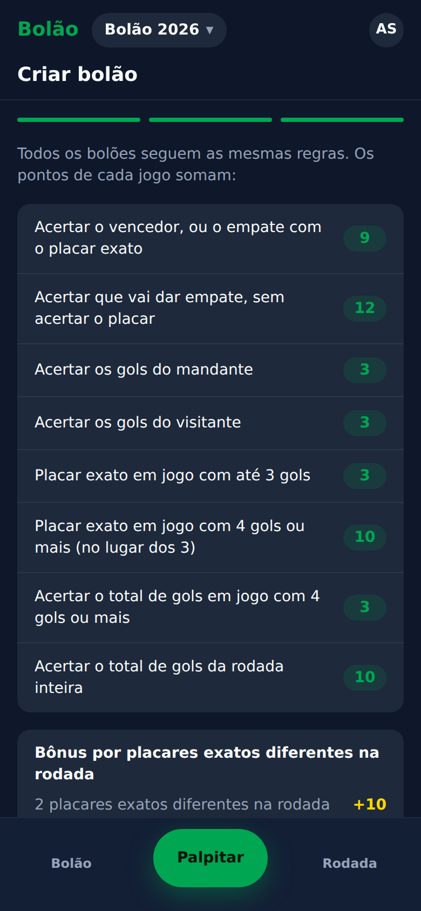

<h1 align="center">Bolão Brasileirão</h1>

  <strong>O bolão do Brasileirão com a sua galera: palpite, acompanhe as parciais e veja quem manda na resenha.</strong>

  <em>A prediction pool for the Brazilian football championship. This README is in Portuguese, because the players are Brazilian. Developer docs are in English: <a href="docs/development.md">docs/development.md</a>.</em>

  <a href="https://bolao.giovani.app"><strong>Abrir o app web</strong></a>
  ·
  App Store e Google Play: em breve

  
  
  

  
  
  

## O que é

O Bolão Brasileirão substitui a planilha do grupo. Cada participante palpita o placar dos jogos de cada rodada. Os jogos e os resultados entram sozinhos, e a classificação sai na hora, sem ninguém precisar fazer conta.

## Como funciona

- **Crie um bolão.** Dê um nome e pronto: todos os bolões seguem as mesmas regras.
- **Convide os amigos com um link.** Quem abre o convite pede para entrar, e você aprova. Também dá para entrar com o código do bolão.
- **Palpite deslizando.** Um card por jogo: ajuste o placar com `+` e `−` e arraste para o próximo. Os palpites fecham no início de cada jogo.
- **Acompanhe as parciais ao vivo.** Veja como a classificação ficaria com os placares do momento e compare seus palpites com os da galera.
- **Classificação.** Geral ou por rodada, com placares exatos e resultados certos de cada um.
- **Hall dos Campeões.** O campeão de cada temporada, o pódio e a classificação final ficam guardados.
- **Lembretes no celular.** Aviso de rodada nova, 1 dia antes e 10 minutos antes de fechar.

## Pontuação

Os pontos de cada jogo somam:

| Acerto | Pontos |
|---|---|
| Vencedor, ou empate com o placar exato | 9 |
| Empate, sem acertar o placar | 12 |
| Gols do mandante | 3 |
| Gols do visitante | 3 |
| Placar exato em jogo com até 3 gols | 3 |
| Placar exato em jogo com 4 gols ou mais | 10 |
| Total de gols em jogo com 4 gols ou mais | 3 |
| Total de gols da rodada inteira | 10 |

Ainda tem bônus por placares exatos diferentes na rodada. As regras completas estão em [SCORING.md](SCORING.md).

## Plataformas

- **Web:** [bolao.giovani.app](https://bolao.giovani.app), no navegador do celular ou do computador. Instale na tela inicial para usar como app e receber os lembretes.
- **iOS e Android:** app nativo, em breve na App Store e no Google Play.

## Privacidade e suporte

- Política de privacidade e termos: [bolao.giovani.app/privacidade](https://bolao.giovani.app/privacidade)
- Suporte: [suporte@giovani.app](mailto:suporte@giovani.app)

---

Para desenvolvedores: [docs/development.md](docs/development.md) (rodar, testar e publicar) e [ARCHITECTURE.md](ARCHITECTURE.md).
